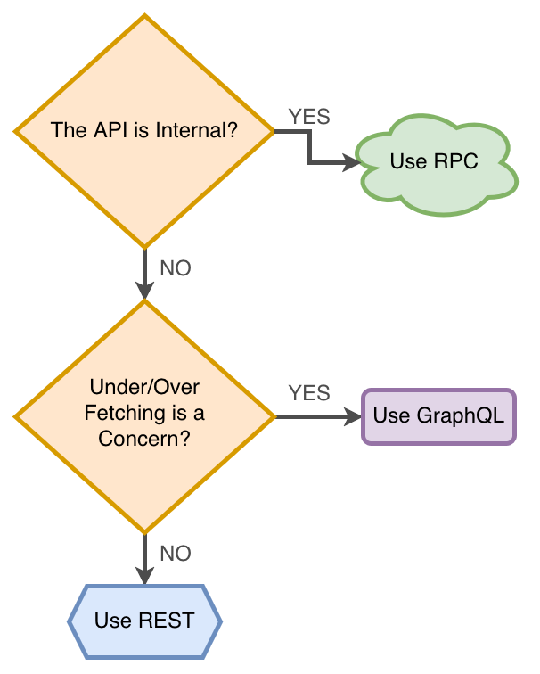

## Types of API

Typically we choose between three main API protocols:

1. REST (Representational State Transfer)
2. GraphQL
3. RPC (Remote Procedure Call)

### REST
REST uses standard HTTP methods (GET, POST, PUT, DELETE) to manipulate resources identified by URLs. REST maps naturally to the database operations and HTTP semantics, making it the go-to protocol for most web services. REST is the default choice.

### GraphQL
REST has fixed endpoints for different operations. On the other hand GraphQL uses the same endpoint with a query language. This allows the clients to specify exactly what data they need in a single query. **Flexible data fetching**, **avoiding over-fetching and under-fetching** are good indications of using GraphQL instead of REST.

#### RPC
It uses serialization and HTTP/2 for effiecient communication between services. In REST everything is resource, btu RPC let's us think in terms of actions and procedures. Use RPC for microservices or internal services to achieve high-performance connections. Use it when performance is critical.

## REST in Details

REST is our default choice for API design. 

