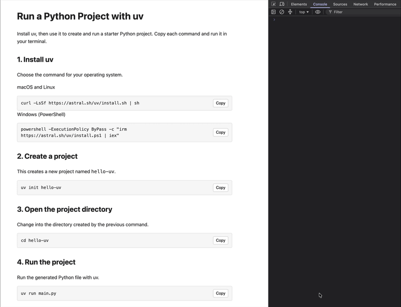

This article shows how to copy text from a web page using JavaScript. When the `Copy` button is clicked, the text inside the `<p>` element below it will be copied to the clipboard.

## Basic Example

```html
<!DOCTYPE html>
<html lang="en">
<head>
    <meta charset="UTF-8">
    <meta name="viewport" content="width=device-width, initial-scale=1.0">
    <title>Document</title>
</head>

<body>
    <div id="copy-to-clipboard">
        <button id="copy-button">Copy</button>

        <p id="text-to-copy">
            This is the first line of text.<br>
            This is the second line of text.<br>
            This is the third line of text.
        </p>
    </div>
</body>
</html>
```
### Preview


You can achieve this with a simple JavaScript DOM manipulation technique. Add a `click` event listener to the copy button:

```javascript
<script>
document.getElementById('copy-button').addEventListener('click', () => {
    const textToCopy = document.getElementById('text-to-copy').innerText;

    const tempTextarea = document.createElement('textarea');
    tempTextarea.value = textToCopy;
    
    document.body.appendChild(tempTextarea);
    tempTextarea.select();
    document.execCommand('copy');
    document.body.removeChild(tempTextarea);
});
</script>
```

Now clicking on the **Copy** button will copy the text to clipboard.

### How It Works

- `const textToCopy = document.getElementById('text-to-copy').innerText;` gets the paragraph's visible text and stores it in `textToCopy`.
- `const tempTextarea = document.createElement('textarea');` creates a temporary text area.
- `tempTextarea.value = textToCopy;` inserts the paragraph text into the text area.
- `document.body.appendChild(tempTextarea);` adds the text area to the page so its text can be selected.
- `tempTextarea.select();` selects the text inside the text area.
- `document.execCommand('copy');` copies the selected text to the clipboard.
- `document.body.removeChild(tempTextarea);` removes the temporary text area from the page.

This technique is useful when a page contains code snippets or commands that users should be able to copy.

## Practical Example:

The example below creates a mock documentation page that explains how to use `uv` to run a Python project. The commands can be copied with the DOM manipulation technique described above.

```html
<!DOCTYPE html>
<html lang="en">
<head>
    <meta charset="UTF-8">
    <meta name="viewport" content="width=device-width, initial-scale=1.0">
    <title>Run a Python Project with uv</title>
    <style>
        body {
            max-width: 720px;
            margin: 40px auto;
            padding: 0 20px;
            color: #222;
            font: 16px/1.6 system-ui, sans-serif;
        }

        h1, h2, p {
            margin-top: 0;
        }

        .step {
            margin-top: 28px;
        }

        .command {
            display: flex;
            align-items: center;
            justify-content: space-between;
            gap: 12px;
            padding: 10px 12px;
            border: 1px solid #ddd;
            border-radius: 4px;
            background: #f7f7f7;
        }

        .command code {
            overflow-x: auto;
            font: 14px/1.5 monospace;
        }

        .copy-button {
            flex: 0 0 auto;
            padding: 5px 9px;
            border: 1px solid #ccc;
            border-radius: 4px;
            background: #fff;
            cursor: pointer;
        }
    </style>
</head>
<body>
    <main>
        <h1>Run a Python Project with uv</h1>
        <p>Install uv, then use it to create and run a starter Python project. Copy each command and run it in your terminal.</p>

        <section class="step">
            <h2>1. Install uv</h2>
            <p>Choose the command for your operating system.</p>
            <p>macOS and Linux</p>
            <div class="command">
                <code id="install-uv-unix">curl -LsSf https://astral.sh/uv/install.sh | sh</code>
                <button class="copy-button" type="button" data-copy-target="install-uv-unix">Copy</button>
            </div>
            <p>Windows (PowerShell)</p>
            <div class="command">
                <code id="install-uv-windows">powershell -ExecutionPolicy ByPass -c "irm https://astral.sh/uv/install.ps1 | iex"</code>
                <button class="copy-button" type="button" data-copy-target="install-uv-windows">Copy</button>
            </div>
        </section>

        <section class="step">
            <h2>2. Create a project</h2>
            <p>This creates a new project named <code>hello-uv</code>.</p>
            <div class="command">
                <code id="create-project">uv init hello-uv</code>
                <button class="copy-button" type="button" data-copy-target="create-project">Copy</button>
            </div>
        </section>

        <section class="step">
            <h2>3. Open the project directory</h2>
            <p>Change into the directory created by the previous command.</p>
            <div class="command">
                <code id="enter-project">cd hello-uv</code>
                <button class="copy-button" type="button" data-copy-target="enter-project">Copy</button>
            </div>
        </section>

        <section class="step">
            <h2>4. Run the project</h2>
            <p>Run the generated Python file with uv.</p>
            <div class="command">
                <code id="run-project">uv run main.py</code>
                <button class="copy-button" type="button" data-copy-target="run-project">Copy</button>
            </div>
        </section>
    </main>

    <script>
        document.querySelectorAll('.copy-button').forEach((button) => {
            button.addEventListener('click', () => {
                const command = document.getElementById(button.dataset.copyTarget).innerText;
                const tempTextarea = document.createElement('textarea');
                tempTextarea.value = command;
                document.body.appendChild(tempTextarea);
                tempTextarea.select();
                document.execCommand('copy');
                document.body.removeChild(tempTextarea);

                button.textContent = 'Copied';
                setTimeout(() => {
                    button.textContent = 'Copy';
                }, 1500);
            });
        });
    </script>
</body>
</html>
```

### Preview



