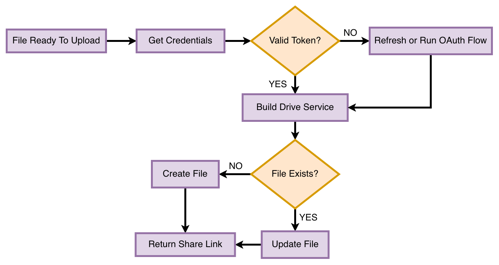

We need to upload a file to Google Drive; Using code — through the Google Drive API with an OAuth 2.0 token. Google Drive does not accept anonymous uploads. Every request must be authenticated.

The upload process works in two phases:
- Auth Phase
- Upload Phase



## Phase 1: The Auth Flow

The auth function reads the client credentials, loads the token, and either refreshes or creates a token.

```python
from __future__ import annotations

from pathlib import Path
from typing import Any

from google.auth.transport.requests import Request
from google.oauth2.credentials import Credentials
from google_auth_oauthlib.flow import InstalledAppFlow
from googleapiclient.discovery import build
from googleapiclient.errors import HttpError
from googleapiclient.http import MediaFileUpload

from src import variables


def get_drive_credentials() -> Credentials:
    client_id = variables.GOOGLE_DRIVE_CLIENT_ID
    client_secret = variables.GOOGLE_DRIVE_CLIENT_SECRET
    if not client_id or not client_secret:
        raise ValueError(
            "Google Drive upload failed: OAuth client credentials are not configured. "
            "Set the GOOGLE_DRIVE_CLIENT_ID and GOOGLE_DRIVE_CLIENT_SECRET environment "
            "variables for your Google Cloud OAuth 2.0 Desktop client."
        )

    token_path = Path(variables.GOOGLE_DRIVE_TOKEN_PATH)
    credentials: Credentials | None = None
    if token_path.exists():
        credentials = Credentials.from_authorized_user_file(token_path, scopes=variables.DRIVE_SCOPES)

    if credentials is None or not credentials.valid:
        if credentials is not None and credentials.expired and credentials.refresh_token:
            credentials.refresh(Request())
        if credentials is None or not credentials.valid:
            flow = InstalledAppFlow.from_client_config(
                {
                    "installed": {
                        "client_id": client_id,
                        "client_secret": client_secret,
                        "auth_uri": "https://accounts.google.com/o/oauth2/auth",
                        "token_uri": "https://oauth2.googleapis.com/token",
                        "redirect_uris": ["http://localhost:8080/"],
                    }
                },
                scopes=variables.DRIVE_SCOPES,
            )
            credentials = flow.run_local_server(port=0)
            token_path.parent.mkdir(parents=True, exist_ok=True)
            token_path.write_text(credentials.to_json(), encoding="utf-8")

    return credentials
```

The `get_drive_credentials` function follows these steps:

1. Read the OAuth client credentials from the environment.
2. Load the saved token from the token file and validate it.
3. If the token is missing or invalid, refresh it or run the local server flow and save the new token.

## Phase 2: The Upload

With valid credentials, the function builds the Drive service and uploads the file.

#### `get_drive_service` builds the authenticated Drive API service from the credentials:

```python
def get_drive_service() -> Any:
    credentials = get_drive_credentials()
    return build("drive", "v3", credentials=credentials)
```

#### `_find_drive_file` finds an existing file by name and returns its id:

```python
def _find_drive_file(service: Any, file_name: str) -> str | None:
    try:
        result = (
            service.files()
            .list(
                q=f"name='{file_name}' and trashed=false",
                pageSize=1,
                fields="files(id,name)",
            )
            .execute()
        )
    except HttpError as error:
        raise ValueError(f"Google Drive upload failed: {error}") from error

    files = result.get("files", [])
    return files[0]["id"] if files else None
```

#### `upload_pdf_to_drive` uploads the file, or updates the existing one, and returns the share link:

```python
def upload_pdf_to_drive(
    file_path: Path, file_name: str = variables.DEFAULT_DRIVE_FILE_NAME
) -> str:
    try:
        service = get_drive_service()
        media = MediaFileUpload(str(file_path), mimetype="application/pdf")
        existing_file_id = _find_drive_file(service, file_name)

        if existing_file_id:
            created = (
                service.files()
                .update(
                    fileId=existing_file_id,
                    media_body=media,
                    fields="id,name,mimeType,webViewLink",
                )
                .execute()
            )
        else:
            created = (
                service.files()
                .create(
                    body={"name": file_name, "mimeType": "application/pdf"},
                    media_body=media,
                    fields="id,name,mimeType,webViewLink",
                )
                .execute()
            )
    except HttpError as error:
        raise ValueError(f"Google Drive upload failed: {error}") from error

    return created.get("webViewLink") or f"https://drive.google.com/file/d/{created.get('id')}/view"
```

The function checks for an existing file with the same name and updates it, or creates a new one, then returns the share link. The update-or-create branch:

```python
if existing_file_id:
    # A file with this name already exists → update it
    service.files().update(
        fileId=existing_file_id,
        media_body=media,
        fields="id,name,mimeType,webViewLink",
    ).execute()
else:
    # No file with this name exists → create a new one
    service.files().create(
        body={"name": file_name, "mimeType": "application/pdf"},
        media_body=media,
        fields="id,name,mimeType,webViewLink",
    ).execute()
```

## How to Get Google Cloud Credentials?

1. Go to the Google Cloud Console: [https://console.cloud.google.com](https://console.cloud.google.com/) and create or select a project.
2. Enable the Google Drive API — go to [https://console.cloud.google.com/apis/library/drive.googleapis.com](https://console.cloud.google.com/apis/library/drive.googleapis.com) and enable it.
3. Configure the OAuth consent screen — go to [https://console.cloud.google.com/auth/audience](https://console.cloud.google.com/auth/audience) and add the Drive scope.
4. Create the OAuth 2.0 Client ID for a Desktop app — go to [https://console.cloud.google.com/apis/credentials](https://console.cloud.google.com/apis/credentials) and create an OAuth client ID with **Desktop app** type.
5. Set the `GOOGLE_DRIVE_CLIENT_ID`, `GOOGLE_DRIVE_CLIENT_SECRET`, and `GOOGLE_DRIVE_TOKEN_PATH` environment variables (e.g., in `.env`).

## Wrapping Up

The upload process authenticates first, then uploads. The auth function handles the token, and the upload function handles the file.
